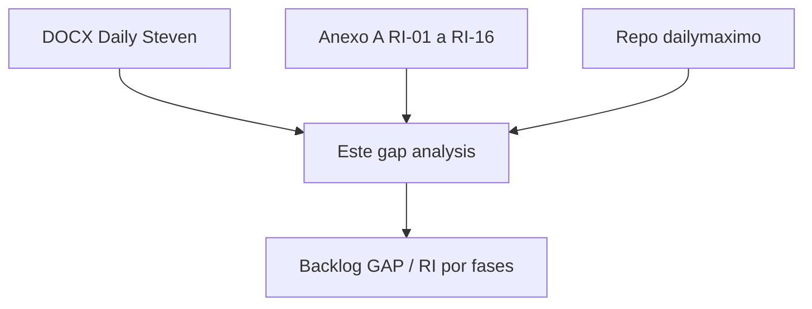

# Gap analysis: Daily Steven (spec) vs Daily Steven (repo)

**Fecha del análisis:** 19/11/2026  
**Estado:** documental + inspección de código. **No** se ha recompilado ni jugado una ROM para este informe.

## Fuentes

| Fuente | Ruta |
|--------|------|
| Spec original (DOCX → texto) | `.cache/daily_steven_instrucciones.txt` (extraído del DOCX de @Horte, 17/11/2026) |
| Spec + Anexo A (revisión independiente) | [`Daily_Steven_instrucciones_y_revision_independiente.md`](Daily_Steven_instrucciones_y_revision_independiente.md) |
| Código actual | repo `dailymaximo` (overlay, web, scripts, patches, content) |
| Notas locales | [`status-al-entrar.md`](status-al-entrar.md), [`../content/NOVEDADES.md`](../content/NOVEDADES.md), [`../AGENTS.md`](../AGENTS.md) |

**Cómo usar este documento**

1. **DEC-0 está cerrado** (19/11/2026). No reabrir identidad, protocolo, escena, RI-01, consumo del día ni el modelo de equipos sin una decisión nueva.
2. Avanzar por fases 0→4; **no saltar puertas**.
3. Cada ítem `GAP-*` / `RI-*` es asignable a un subagente con criterio de done explícito.
4. Los símbolos de código (`DailyMax`, `DAILYMAX-*`, carpeta `dailymaximo`) se quedan. El nombre de producto y la semilla son Daily Steven / `dailysteven:`.

---

## Veredicto

Hay un **juego diario jugable** (capa Daily + web local + dobles HoL), pero **no cumple** la especificación cerrada del DOCX ni las puertas del Anexo A. Varias piezas “hechas” **divergen** de lo pedido (protocolo, Gen3, escena, 8 combinaciones, nombres).



---

## OPEN-PRODUCT — cerrado el 19/11/2026

Estas diferencias con el DOCX ya tienen respuesta. El código de producto debe seguir la columna **Decisión**, no el DOCX literal cuando choquen.

| ID | Tema | DOCX | Decisión | Estado en código |
|----|------|------|----------|------------------|
| OPEN-P1 | Nombre / id | Daily Steven / `dailysteven` | **Daily Steven / `dailysteven`** | Manifest y web actualizados. Símbolos C y el `.gba` siguen en `dailymaximo` |
| OPEN-P2 | Nombres en la ROM | STEVEN, AURA, WALLY | **STEVEN, AURA, BLASCO** | Parche aplicado en `hall_of_legends.h`. Hace falta recompilar la ROM |
| OPEN-P3 | Protocolo | `DAILYRED-CONF-V2` | **Mantener `DAILYMAX-CONF-V1` + `dailymax-conf-v1+status-v1`** | Hecho. El launcher necesitará adaptador `dailymax-*` |
| OPEN-P4 | Escenario | Sala de Bruno + cinemática | **Sala de Bruno + cinemática completa** | **Pendiente (GAP-F2-06).** Hoy sigue la sala del campeón y el combate inmediato |
| OPEN-P5 | Prefijo semilla | `dailysteven:` | **`dailysteven:`** | Hecho en `web/daily.js` y el manifest |

**RI-06:** el protocolo no vuelve a `DAILYRED`. Hay que validar el layout binario de `DAILYMAX-*` y añadir el adaptador en Hortelano's Daily (GAP-F4-06).

---

## DEC-0 — preguntas bloqueantes (responder antes de implementar producto)

Rellenar la columna **Respuesta** cuando el equipo decida.

| ID | Pregunta | Opciones | Impacto | Respuesta |
|----|----------|----------|---------|-----------|
| DEC-0.1 | ¿Identidad del producto? | Daily Steven. En la ROM: **STEVEN**, **AURA**, **BLASCO** (Steven no se traduce a Máximo; Wally se anuncia Blasco) | **Cerrado** |
| DEC-0.2 | ¿Protocolo web/launcher? | Mantener `DAILYMAX-*` y añadir adaptador en el launcher | **Cerrado** |
| DEC-0.3 | ¿Escena / mapa? | Sala de Bruno + cinemática completa | **Cerrado** (implementación = GAP-F2-06) |
| DEC-0.4 | ¿RI-01 Terremoto/Surf? | En 3.ª gen, Surf golpea a los dos rivales con reducción del 50 % y no al aliado. Terremoto golpea al resto del campo, aliado incluido, sin esa reducción | **Cerrado** |
| DEC-0.5 | ¿Cuándo se consume el día? | Al empezar el combate (`PHASE.BATTLE`), como ahora | **Cerrado** |
| DEC-0.6 | ¿Variantes 2+1? | **No hay 8 combinaciones de momento.** Si sale Aura, su equipo es siempre el mismo. Si sale Blasco, el suyo es siempre el otro. Equipos típicos provisionales; se sustituyen cuando lleguen los definitivos. No inventar variantes | **Cerrado** |

**Regla:** no cambiar estas filas en código sin una decisión nueva. GAP-F2-02 (8 combinaciones) queda **aplazado** hasta que se pidan variantes.

---

## Matriz de cumplimiento (DOCX vs repo)

Leyenda: **DONE** · **PARTIAL** · **DIVERGES** · **MISSING** · **N/A (pending content)**

### Fase 0 — Viabilidad Gen3

| Requisito | Estado | Evidencia / notas |
|-----------|--------|-------------------|
| Compilar HoL / expansion en Windows | DONE | Docker/`_docker_build.sh` + README; informe [`fase0-gen3-informe.md`](fase0-gen3-informe.md) |
| `GEN_LATEST = GEN_3` | DONE | Parche Daily; ROM jugada en navegador |
| Limitar especies 4ª+ en `species_enabled.h` | PARTIAL | `P_GEN_4_POKEMON FALSE`. `P_GEN_4_CROSS_EVOS` TRUE (Gallade provisional) |
| Auditar `B_*` / `I_*` / `P_*` | DONE | Lista en informe Fase 0 |
| Checklist mecánicas Gen3 (crítico×2, split por tipo, Protect 50%, etc.) | PARTIAL | Config OK; Surf/EQ observados; resto sin medir daño |
| Surf/Terremoto según RI-01 | DONE | DEC-0.4 + sondas 900001/900002; freeze ES `B_BUFF3` |
| Icono físico/especial en resumen (RI-04) | DONE | `B_SHOW_CATEGORY_ICON FALSE` en árbol compilado |
| Informe de salida Fase 0 | DONE | [`fase0-gen3-informe.md`](fase0-gen3-informe.md) — puerta cerrada |

### Fase 1 — Capa Daily

| Requisito | Estado | Evidencia / notas |
|-----------|--------|-------------------|
| Arranque directo sin selector HoL / rondas | DONE | Boot daily + warp campeón |
| Especiales OnBattleStart/Result/Finish + status RAM | DONE | `overlay/src/dailymaximo.c` |
| Config en ROM buscable por magic | DONE (DEC-0.2) | Magic `DAILYMAX-*`; adaptador launcher = GAP-F4-06 |
| Layout seed/wins/battles/daily + phase/result | DONE (layout) | Mismo shape; nombres distintos |
| `protocolId` sin cambiar | DONE (DEC-0.2) | `dailymax-conf-v1+status-v1` mantenido a propósito |
| Día jugado al combate / abandon=loss / práctica `?seed=` | DONE | `PHASE.BATTLE` + `markBattleStarted` (DEC-0.5) |
| Equipo: 6 distintos gen1–3 L100 | DONE | `dailymaximo_team.c` |
| BST mínimo 2850 (recalibrar) | DIVERGES | `2700` provisional documentado; RI-16 → GAP-F3-02 |
| 1/8 legendario | DONE | `LEGENDARY_TEAM_ODDS 8` |
| Moves: todos los aprendibles + ≥1 daño | DONE | Level/TM/tutor/egg + ≥1 daño en `AssignRandomMoveset` |
| IV 25–31, AssignFocusedEVs | DONE | |
| Item battle list **o** type booster | DONE | `sBattleItems` + `sTypeBoostItems` si hay move de ese tipo |
| RNG propio solo semilla | DONE | `ISO_RANDOMIZE1` |
| Menú start reducido | PARTIAL | HoL versus + QUIT oculto; no auditado 1:1 vs Gold |
| Party SUMMARY/SWITCH/CANCEL | PARTIAL | No forzado en daily |
| No whiteout / no bag | DONE | Flags/vars HoL |

### Fase 2 — Contenido Steven / Máximo

| Requisito | Estado | Evidencia / notas |
|-----------|--------|-------------------|
| 3 bits semilla → 8 combinaciones | N/A (DEC-0.6) | Aplazado; un trío fijo por compañero |
| RNG matchup ≠ RNG equipo jugador | PARTIAL | Bit compañero independiente del stream de equipo |
| Archivo datos 2 fijos + 2 variantes / entrenador | PARTIAL | `dailymaximo_rivals.c` — 1 trío/entrenador (sin variantes) |
| Marcado PROVISIONAL | DONE | Comentario cabecera del archivo |
| Validador gen3/learnset (RI-10) | MISSING | Archivo provisional ya evita Gallade/Iron Head/etc.; falta CI |
| Fusión 3+3, dueño real, dos sprites, frases | DONE | Vía HoL + run activo |
| Hooks sin romper `HoL_IsActive` (RI-05) | PARTIAL | Mitigado arrancando run HoL; faltan pruebas ROM |
| Sala Bruno + escena puerta | DIVERGES / MISSING | Campeón + skip; NOVEDADES aún menciona puerta (stale) |
| Reset práctica in-room | MISSING | Práctica = reload `?seed=` |
| Textos ES consolidados + STEVEN/AURA/WALLY | DIVERGES | STEVEN/BLASCO; textos en patches HoL |

### Fase 3 — IA

| Requisito | Estado | Evidencia / notas |
|-----------|--------|-------------------|
| Mismas AI flags que HoL | DONE | Basic/Omniscient/Smart Switching/…/Prediction |
| Sin portar reglas Gold | DONE | |
| Pruebas dirigidas RI-12 | MISSING | |
| Corrección Surf-como-daño-aliado (RI-01) | MISSING | Pendiente DEC-0.4 |

### Fase 4 — Web / launcher / release

| Requisito | Estado | Evidencia / notas |
|-----------|--------|-------------------|
| Portada solo jefe | DONE | `web/game/maximo.png` |
| Sin iconos equipo rival | DONE | No hay `web/game/team/` |
| Claves stats/muted aisladas | PARTIAL | Manifest `hortelano:dailymaximo:*` vs runtime `dailymaximo-stats` / `dailymaximo-muted` (RI-07) |
| Archive + team-preview expansion (RI-08) | MISSING | No existen en este repo |
| Tests smoke/site/teams | MISSING | |
| `.github` release + CONTENT_RELEASES / RELEASE_NOTES | MISSING | Solo AGENTS.md + NOVEDADES |
| Content pack zip + catálogo launcher (RI-15) | MISSING | |
| Castellano inventario completo (RI-11) | PARTIAL | `locale/es/` amplio; sin inventario/pruebas formales |

### Criterios de aceptación DOCX (resumen)

| Área | Hechas | Parciales / divergen | Faltan |
|------|--------|----------------------|--------|
| Juego | Compila (parcial), doubles, dueños, fusión, AI flags base, win/loss web | Gen3, equipo jugador rules, nombres, escena | 8 combos, datos rivales, Bruno cinematic, informe Gen3, tests |
| Web/launcher | Portada jefe, daily loop local | Protocolo, claves | site tests, archive, launcher, release CI |

---

## Anexo A — RI-01 … RI-16 (estado en este repo)

| ID | Resumen | Estado en repo | ¿Aprobación humana? | Acción |
|----|---------|----------------|---------------------|--------|
| RI-01 | Spec Surf/Terremoto incorrecta | DEC-0.4 + sondas OK; freeze ES arreglado | **Sí** (DEC-0.4) | Hecho en Fase 0 |
| RI-02 | Contradicción consumo del día | Combate → `PHASE.BATTLE` (DEC-0.5) | **Sí** (DEC-0.5) | Documentado; sin cambio de protocolId |
| RI-03 | Gen3 = más que GEN_LATEST | Motor Gen4; sin auditoría | No (mantiene requisito) | GAP-F0-01…03 |
| RI-04 | Icono split en resumen | No verificado | No | GAP-F0-04 |
| RI-05 | Hooks HoL_IsActive / merge | Mitigado vía run HoL + patches DailyMax; sin battery ROM | No | GAP-F2-05 |
| RI-06 | Contrato binario marcas/layout | Layout OK; marcas forked | **Sí** si se cambia a DAILYRED (DEC-0.2) | GAP-F1-01 / OPEN-P3 |
| RI-07 | Claves web ≠ launcher | Divergencia real | No | GAP-F4-01 |
| RI-08 | Archive/preview no transferibles | Ausentes | No | GAP-F4-02 |
| RI-09 | Provisionales ≠ 8 variantes | Solo stock 3+3; 2 partners | **Sí** si se inventa contenido (DEC-0.6) | GAP-F2-01…03 |
| RI-10 | Filtrar illegal Gen4 en HoL parties | Sin validador | No | GAP-F2-04 |
| RI-11 | Inventario es-ES | Locale parcial | No (glosario nombres → DEC-0.1) | GAP-F2-07 / GAP-F4-03 |
| RI-12 | Casos IA dirigidos | Falta | No | GAP-F3-01 |
| RI-13 | Núcleo / motor / contenido | Overlay Daily + patches mezclados | No | GAP-F1-06 (mejora continua) |
| RI-14 | Seed 0 + Windows reproducible | README Docker; sin doc seed 0 formal | No | GAP-F0-05 / GAP-F1-05 |
| RI-15 | Publicar tras pruebas; no romper Red/Gold | Sin CI/launcher entry | No | GAP-F4-05 |
| RI-16 | Simular BST antes de proponer | 2700 fijo sin sim | **Sí** al fijar nuevo mínimo | GAP-F3-02 |

---

## Backlog ejecutable (IDs estables)

Convención: `GAP-F{fase}-{nn}` · prioridad `P0` (bloquea) · `P1` (alto) · `P2` (medio) · `P3` (luego).

### DOC / DEC (ya en curso)

| ID | Título | Pri | Deps | Subagente | Criterio done |
|----|--------|-----|------|-----------|---------------|
| GAP-DOC-01 | Este gap analysis | P0 | — | docs | Archivo en `docs/` con matriz + backlog |
| GAP-DOC-02 | Spec+Anexo A en repo | P0 | — | docs | `docs/Daily_Steven_instrucciones_y_revision_independiente.md` presente |
| GAP-DEC-00 | Respuestas DEC-0.1–0.6 | P0 | GAP-DOC-01 | humano | Tabla DEC-0 rellenada |

### Fase 0 — Viabilidad Gen3 · subagente `engine-config`

**Puerta:** no avanzar a Fase 1 de motor Gen3 hasta informe con casos observados.

| ID | Título | Pri | Deps | Archivos tocados (previstos) | Criterio done |
|----|--------|-----|------|------------------------------|---------------|
| GAP-F0-01 | Forzar `GEN_LATEST=GEN_3` en overlay/patch Daily | P0 | DEC-0 (implícito OK Gen3) | overlay/scripts o patch post-HoL, `include/config/general.h` | **DONE** |
| GAP-F0-02 | Desactivar especies Gen4+ en daily | P0 | GAP-F0-01 | `species_enabled.h` vía script | **DONE** (`P_GEN_4_CROSS_EVOS` provisional) |
| GAP-F0-03 | Auditoría `B_*`/`I_*`/`P_*` + informe | P0 | GAP-F0-01 | `docs/fase0-gen3-informe.md` | **DONE** |
| GAP-F0-04 | RI-01/RI-04: checklist mecánicas + UI resumen | P0 | DEC-0.4, GAP-F0-03 | informe + (si hace falta) UI patch | **DONE** Surf/EQ+icono; Protect/crit/split = config |
| GAP-F0-05 | RI-14: documentar Windows/Docker/seed 0 | P1 | — | README o `docs/build-windows.md` | **DONE** |

### Fase 1 — Núcleo Daily · subagente `daily-core`

**Puerta:** DEC-0.2 y DEC-0.5 resueltos antes de tocar protocolo/fases.

| ID | Título | Pri | Deps | Archivos tocados (previstos) | Criterio done |
|----|--------|-----|------|------------------------------|---------------|
| GAP-F1-01 | Alinear protocolo según DEC-0.2 | P0 | DEC-0.2 | overlay magic, `web/rom-config.js`, `game-link.js`, manifest | **DONE** — se mantienen `DAILYMAX-*` |
| GAP-F1-02 | Moveset completo + ≥1 daño | P0 | — | `overlay/src/dailymaximo_team.c` | **DONE** — `AssignRandomMoveset` |
| GAP-F1-03 | Items: battle list **o** type booster | P1 | GAP-F1-02 | `dailymaximo_team.c` | **DONE** — battle + type boost |
| GAP-F1-04 | BST: volver a 2850 **o** dejar 2700 marcado provisional + nota RI-16 | P1 | — | `dailymaximo_team.c`, este doc | **DONE** — 2700 provisional → F3-02 |
| GAP-F1-05 | Semántica consumo día (DEC-0.5) | P0 | DEC-0.5, escena | overlay status + `web/app.js` | **DONE** — consumo en `PHASE.BATTLE` |
| GAP-F1-06 | Party menu SUMMARY/SWITCH/CANCEL en daily | P2 | — | party_menu hooks | Pendiente |
| GAP-F1-07 | RI-13: separar constantes contenido vs núcleo | P2 | — | overlay layout | Pendiente (deuda documentada) |

### Fase 2 — Contenido · subagente `steven-content`

**Puerta:** DEC-0.1, DEC-0.3, DEC-0.6; Fase 0 OK si se exige Gen3 en datos.

| ID | Título | Pri | Deps | Archivos tocados (previstos) | Criterio done |
|----|--------|-----|------|------------------------------|---------------|
| GAP-F2-01 | Archivo datos rivales editable + PROVISIONAL | P0 | DEC-0.6 | `overlay/src/dailymaximo_rivals.c` | **DONE** |
| GAP-F2-02 | Matchup: solo Aura o Blasco, equipo fijo cada uno | P0 | DEC-0.6 | `dailymaximo.c` + rivals | **DONE** |
| GAP-F2-03 | Montar parties desde archivo (no solo HoL stock) | P0 | GAP-F2-01/02 | `DailyMax_CreateOpponentParties` | **DONE** |
| GAP-F2-04 | Validador gen3/learnset (RI-10) | P0 | GAP-F2-01, GAP-F0-01 | script/test | Falla CI/build si move/sp ilegal |
| GAP-F2-05 | Battery RI-05 fusión/dueño/sprites/IA | P0 | run daily | tests o checklist manual firmada | Evidencia en informe |
| GAP-F2-06 | Mapa/escena según DEC-0.3 | P0 | DEC-0.3 | maps/scripts patches | Cumple opción elegida; NOVEDADES coherente |
| GAP-F2-07 | Textos consolidados ES + nombres DEC-0.1 | P1 | DEC-0.1 | `locale_guard` + battle table | **PARTIAL** — Protección + efectos TEAM/Your-Opposing; quedan ~49 STRINGID EN |
| GAP-F2-08 | Reset práctica in-room (si hay escena) | P2 | GAP-F2-06 | scripts | Companion oculto; sala reiniciable |

### Fase 3 — IA / equilibrio · subagente `ai-balance`

| ID | Título | Pri | Deps | Archivos tocados (previstos) | Criterio done |
|----|--------|-----|------|------------------------------|---------------|
| GAP-F3-01 | Casos IA dirigidos RI-12 (+ RI-01 si OK) | P1 | GAP-F2-05, DEC-0.4 | `docs/fase3-ai-casos.md` (+ código solo si fallo demostrado) | ≥ casos listados con resultado |
| GAP-F3-02 | Simulación BST (RI-16); **proponer** mínimo | P1 | GAP-F2-02 (8 combos o nota) | informe + propuesta | Número propuesto; no aplicado sin OK |

### Fase 4 — Web / release · subagente `web-release`

**Puerta:** no tocar catálogo launcher hasta pack validado (RI-15).

| ID | Título | Pri | Deps | Archivos tocados (previstos) | Criterio done |
|----|--------|-----|------|------------------------------|---------------|
| GAP-F4-01 | Unificar claves stats/muted (RI-07) | P0 | DEC-0.1 naming | `web/daily.js`, `app.js`, manifest | Misma clave en standalone y manifest |
| GAP-F4-02 | Archive + team-preview expansion (RI-08) | P1 | symbols ELF | `web/archive-party.js`, `team-preview.js`, `scripts/gen-archive-assets.mjs`, `archive/` | Preview = party ROM en N semillas; no spoilear companion |
| GAP-F4-03 | Inventario/pruebas es-ES (RI-11) | P1 | — | checklist locale | Inventario + gaps listados |
| GAP-F4-04 | Portar tests smoke/site/teams | P0 | GAP-F1-01 | `tests/*.mjs`, package scripts | `npm run site` (o equiv.) verde |
| GAP-F4-05 | Release CI + docs CONTENT_RELEASES / RELEASE_NOTES | P1 | GAP-F4-04 | `.github/workflows`, `docs/` | Push main → release; NOVEDADES enforced |
| GAP-F4-06 | Content pack + entrada launcher + regresión Red/Gold | P1 | GAP-F4-04/05, DEC-0 | hortelanos-daily (fuera) + zip | Pack instala; Red/Gold OK |

---

## Orden de trabajo y puertas

Sigue Anexo A §A.5.

1. **DOC-0** — este archivo + spec en `docs/` ← *hecho al crear este doc*
2. **DEC-0** — respuestas humanas (tabla arriba)
3. **Fase 0** — `engine-config` → informe Gen3; **STOP si falla**
4. **Fase 1** — `daily-core` → protocolo/equipo/consumo día
5. **Fase 2** — `steven-content` → rivales/escena/textos/validador
6. **Fase 3** — `ai-balance` → IA dirigida + propuesta BST
7. **Fase 4** — `web-release` → claves/archive/tests/CI; launcher al final

**Entregable por fase:** informe corto (qué cambió, cómo probar, qué pasó, qué falta, discrepancias humanas). No marcar verificado sin resultado ejecutado.

### Prompt mínimo para subagente

```text
Repo: dailymaximo
Lee docs/gap-analisis-daily-steven.md y docs/Daily_Steven_instrucciones_y_revision_independiente.md
Trabaja SOLO los IDs: GAP-F…-…
No toques OPEN-P* ni cambies reglas de juego sin DEC-0 respondido.
Al terminar: actualizar la fila Estado de cada ID en el gap doc y dejar informe en docs/.
```

---

## Notas de deuda / inconsistencias locales

- [`../content/NOVEDADES.md`](../content/NOVEDADES.md) menciona salida por puerta del compañero; el código salta la cinemática → **stale**; corregir al cerrar GAP-F2-06.
- Manifest apunta a `archive/symbols.json` pero `archive/` no existe → GAP-F4-02.
- `DailyMax_MaybeApplyStatus` es stub documentado; fuera del DOCX original (extra local).

---

## Historial de este análisis

| Fecha | Qué |
|-------|-----|
| 19/11/2026 | Primer gap analysis cruzando DOCX + Anexo A vs repo |
| 19/11/2026 | DEC-0 cerrado. Fase 0: `GEN_LATEST GEN_3`, `P_GEN_4_POKEMON FALSE`, icono de categoría oculto. Informe: [`fase0-gen3-informe.md`](fase0-gen3-informe.md) |
| 19/11/2026 | Fase 0 puerta cerrada (Surf/EQ en emulador). Fase 1 P0/P1: moveset completo, type boosters, BST 2700 provisional, protocolo/consumo día documentados. Informe: [`fase1-daily-core-informe.md`](fase1-daily-core-informe.md) |
| 19/11/2026 | Handoff: [`pending.md`](pending.md). Rivales pokepaste Aura/Blasco en `dailymaximo_rivals.c`. Siguiente típico: GAP-F2-06 o F2-04/05. |
